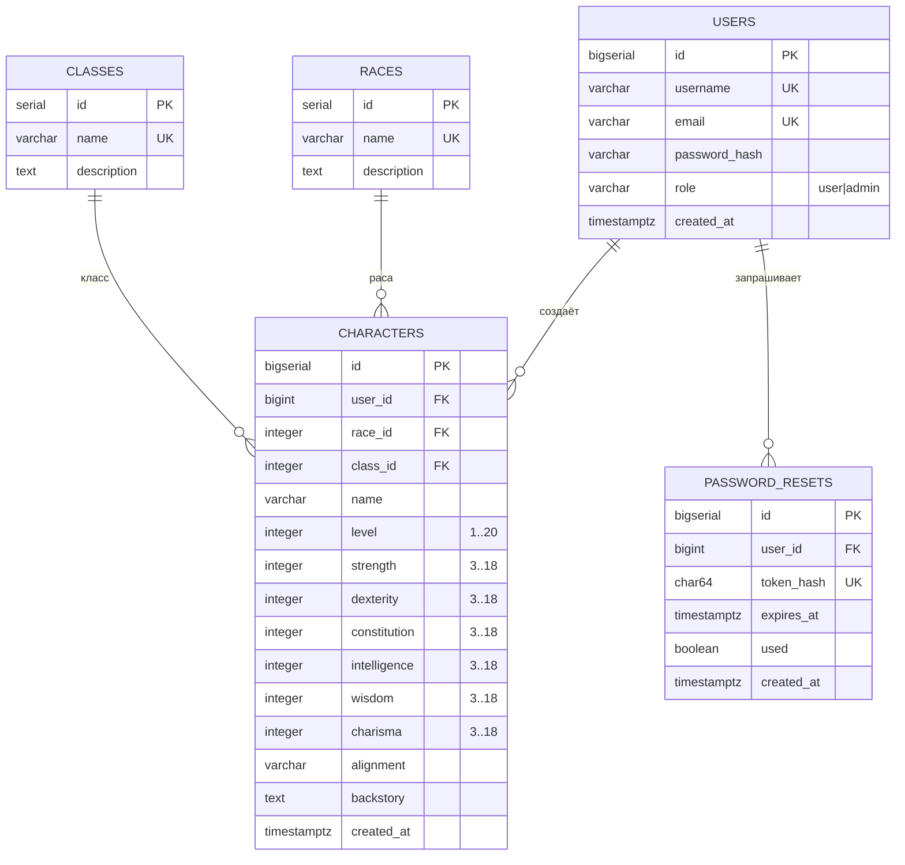

# Персонажи D&D — PHP MVC без фреймворков

Учебное веб-приложение для учёта персонажей настольной игры D&D: регистрация игроков,
создание персонажей, публичный поиск, личный кабинет и админ-панель.
Реализовано на **чистом PHP 8 (MVC, PDO)** без каких-либо фреймворков и библиотек,
в качестве СУБД используется **PostgreSQL**.

## Быстрый старт (Docker)

```bash
docker compose up -d --build
```

Поднимутся два контейнера:

| Сервис | Что это | Порт |
|--------|---------|------|
| `db`   | PostgreSQL 16, при первом старте автоматически накатываются `database/schema.sql` и `database/seed.sql` | `5433` (доступ с хоста) |
| `app`  | PHP 8.2 + Apache, DocumentRoot = `public/` | **http://localhost:8080** |

Открыть приложение: **http://localhost:8080**

Пароли БД и параметры подключения контейнеру передаются переменными окружения
(`DB_HOST=db` и т.д.), поэтому локальный `config/config.php` в docker-режиме не нужен.

### Ручной запуск (без Docker)

1. Создать базу и пользователя PostgreSQL, затем импортировать:

   ```bash
   createdb dnd
   psql -d dnd -f database/schema.sql
   psql -d dnd -f database/seed.sql
   ```

2. Скопировать `config/config.example.php` в `config/config.php` и вписать свои данные.
3. Запустить сервер: `php -S localhost:8000 -t public`.

### Тестовые аккаунты (из seed.sql)

| Логин | Пароль | Роль |
|-------|--------|------|
| `admin`   | `admin123`    | admin |
| `aragorn` | `password123` | user |
| `gimli`   | `password123` | user |

---

## Структура проекта: где что лежит

```
.
├── public/
│   └── index.php              # единственная точка входа: автозагрузка, маршруты, запуск роутера
├── src/
│   ├── bootstrap.php          # инициализация: конфиг, сессия, режим ошибок, хелперы
│   ├── Core/
│   │   ├── Database.php       # обёртка PDO (singleton): exceptions, FETCH_ASSOC, EMULATE_PREPARES=false
│   │   ├── Router.php         # роутер по ?r=имя_маршрута; 404/500
│   │   ├── Controller.php     # базовый контроллер: render(), redirect(), requireLogin(), requireAdmin()
│   │   └── Model.php          # базовая модель: find/all/delete по таблице
│   ├── Models/
│   │   ├── User.php           # пользователи: create, findByUsername/Email, поиск, роли
│   │   ├── Character.php      # персонажи: CRUD, latest(5), topClasses, random, counters, search
│   │   ├── Race.php           # справочник рас (+ usageCount — запрет удаления используемых)
│   │   ├── CharClass.php      # справочник классов
│   │   └── PasswordReset.php  # одноразовые токены восстановления пароля (в БД — только хеш)
│   ├── Controllers/
│   │   ├── HomeController.php        # главная (счётчики, последние 5, топ классов, случайный), карточка персонажа
│   │   ├── AuthController.php        # регистрация, вход (session_regenerate_id), выход
│   │   ├── CharacterController.php   # «мои персонажи», создание/правка/удаление, поиск, пагинация
│   │   ├── PasswordResetController.php # запрос ссылки + установка нового пароля (ссылка пишется в logs/)
│   │   ├── AdminController.php       # дашборд, пользователи, персонажи, расы и классы (CRUD)
│   │   └── ErrorController.php       # страницы 404 / 500
│   ├── Validators/
│   │   └── CharacterValidator.php    # серверная валидация формы персонажа: массив ошибок по полям
│   └── Helpers/
│       └── functions.php             # e(), url(), flash, CSRF, current_user(), require_login/admin()
├── views/
│   ├── layout.php             # общий шаблон; меню зависит от роли (гость/юзер/админ)
│   ├── home.php               # публичная главная
│   ├── auth/                  # login.php, register.php
│   ├── characters/            # _form.php (общая форма), create, edit, my, search, view
│   ├── password/              # request.php, reset.php
│   ├── admin/                 # dashboard, users, user_form, characters, character_edit, races, classes ...
│   └── errors/                # 404.php, 500.php
├── assets/
│   ├── style.css              # оформление (тёмная «фэнтезийная» тема)
│   └── app.js                 # JS-валидация формы персонажа: подсветка полей + сообщения
├── config/
│   ├── config.example.php     # пример конфигурации (в git)
│   └── config.php             # реальный конфиг с паролями (в git НЕ попадает)
├── database/
│   ├── schema.sql             # схема: users, races, classes, characters, password_resets + FK/UNIQUE/индексы
│   └── seed.sql               # тестовые данные: 6 рас, 8 классов, админ, 2 игрока, 3 персонажа
├── logs/                      # в git не попадает; сюда пишутся ссылки восстановления пароля
├── Dockerfile                 # php:8.2-apache + pdo_pgsql
├── docker-compose.yml         # сервисы db (postgres:16) и app
├── composer.json              # PSR-4 маппинг App\ => src/ (автозагрузка своя, composer не обязателен)
└── README.md
```

## Маршруты

Роутинг сделан по query-параметру `?r=...` (не требует mod_rewrite и работает в
встроенном сервере PHP, и в Apache, и в Docker).

| URL | Страница | Доступ |
|-----|----------|--------|
| `?r=home` | Главная: счётчики, последние 5 персонажей, топ классов, случайный персонаж | публичный |
| `?r=character_view&id=N` | Карточка персонажа с модификаторами характеристик | публичный |
| `?r=characters_search` | Поиск: имя, раса, класс, уровень от–до, мировоззрение + пагинация | публичный |
| `?r=login`, `?r=register`, `?r=logout` | Вход / регистрация / выход | публичный |
| `?r=password_request`, `?r=password_reset&token=...` | Восстановление пароля | публичный |
| `?r=characters_my` | Кабинет: список своих персонажей | авторизованный |
| `?r=characters_create` | Создание персонажа (валидация JS + сервер) | авторизованный |
| `?r=characters_edit&id=N` | Редактирование (проверка владельца) | владелец или админ |
| `?r=characters_delete` | Удаление (только POST + CSRF) | владелец или админ |
| `?r=admin` | Дашборд | admin |
| `?r=admin_users`, `?r=admin_user_create`, `?r=admin_user_role`, `?r=admin_user_delete` | Пользователи: список/поиск, создание, смена роли, удаление (себя нельзя) | admin |
| `?r=admin_characters`, `?r=admin_character_edit`, `?r=admin_character_delete` | CRUD персонажей | admin |
| `?r=admin_races`, `?r=admin_race_*`, `?r=admin_classes`, `?r=admin_class_*` | CRUD справочников (используемые удалить нельзя) | admin |

## База данных

5 таблиц: `users`, `races`, `classes`, `characters`, `password_resets`.

### ER-диаграмма (Mermaid)



> [!tip] Ключевые ограничения:

* `users.username` и `users.email` — `UNIQUE`;
* внешние ключи: `characters.user_id → users` (ON DELETE CASCADE),
  `characters.race_id → races`, `characters.class_id → classes`,
  `password_resets.user_id → users` (ON DELETE CASCADE);
* индексы на `characters(user_id)`, `characters(race_id)`, `characters(class_id)`, `characters(level)`;
* CHECK-ограничения на уровень (1–20) и характеристики (3–18), роль (`user`/`admin`).

## Возможности по этапам

1. **Каркас** — своя PSR-4 автозагрузка, роутер, базовые Controller/Model, конфиг вне git.
2. **БД** — schema.sql + seed.sql, FK, UNIQUE, индексы, CHECK.
3. **Ядро** — Database на PDO (исключения, FETCH_ASSOC, EMULATE_PREPARES=false),
   layout с меню по роли, хелперы `e()`, flash, CSRF.
4. **Аутентификация** — `password_hash`/`password_verify`, `session_regenerate_id(true)`
   после входа, в сессии `user_id` и `role`, единый текст ошибки входа.
5. **Публичная страница** — последние 5 персонажей, топ классов (GROUP BY + COUNT + AVG),
   случайный персонаж (`ORDER BY random()`), счётчики, карточка с модификаторами
   (модификатор = `floor((значение − 10) / 2)`).
6. **Форма персонажа** — 12 полей: имя, раса, класс, уровень, 6 характеристик,
   мировоззрение, предыстория; JS-валидация с подсветкой и сообщениями под полями;
   серверная валидация `CharacterValidator` возвращает массив ошибок по полям;
   при ошибке форма показывается заново с введёнными значениями; при успехе —
   редирект + flash.
7. **Поиск** — GET-форма, динамическая сборка `WHERE` из условий и массива параметров
   PDO, экранирование `%` и `_` в LIKE (проверено: `name=%` и `name=ТестовыйXГерой`
   ничего не находят), пагинация LIMIT/OFFSET, сообщение «Ничего не найдено».
8. **Кабинет** — «Мои персонажи», редактирование с проверкой владельца,
   удаление (POST + CSRF + confirm).
9. **Админка** — дашборд со счётчиками, пользователи с поиском, создание админа,
   смена роли, удаление (себя нельзя: ни сменить роль, ни удалить), CRUD персонажей,
   CRUD рас и классов (используемые удалить нельзя), проверка роли в каждом действии.
10. **Восстановление пароля** — форма с email, одинаковый ответ независимо от наличия
    аккаунта; токен `random_bytes(32)`, в БД — SHA-256-хеш и срок жизни (1 час);
    ссылка на время разработки пишется в `logs/password_reset.log`; токен одноразовый.
11. **Финал** — PHPDoc на всех классах и методах, см. чек-лист безопасности ниже.

## Безопасность (чек-лист)

| Угроза | Защита |
|--------|--------|
| SQL-инъекции | Все запросы — через подготовленные выражения PDO, `EMULATE_PREPARES=false`; в LIKE экранируются `%`, `_` и `\`; числа приводятся к `int` |
| XSS | Весь вывод через `e()` (`htmlspecialchars` с ENT_QUOTES); CSP-заголовок не добавлен — учебный проект |
| CSRF | Токен в сессии, скрытое поле в каждой форме, `hash_equals()` на сервере, у всех изменяющих действий только POST |
| Кража сессии | Cookie `HttpOnly`, `SameSite=Lax`, `Secure` по HTTPS; `session_regenerate_id(true)` после входа |
| Подбор пароля | Единый текст ошибки «Неверное имя пользователя или пароль» |
| Хранение паролей | `password_hash()` (bcrypt), `password_verify()`; пароли в открытом виде нигде не сохраняются |
| Раскрытие наличия аккаунта | Восстановление пароля отвечает одинаково в любом случае |
| IDOR (чужие данные) | Проверка владельца при правке/удалении персонажа; `requireAdmin()` в каждом действии админки |
| Токен восстановления | Только хеш в БД, срок 1 час, одноразовость, старые токены инвалидируются |
| Утечка конфига | `config/config.php` и `logs/` в `.gitignore` |

## Полезные SQL-проверки (этап 2)

```sql
-- количество персонажей по классам
SELECT cl.name, COUNT(*) FROM characters c JOIN classes cl ON cl.id = c.class_id GROUP BY cl.name;
-- персонажи с расой и классом
SELECT c.name, r.name, cl.name, c.level FROM characters c
JOIN races r ON r.id = c.race_id JOIN classes cl ON cl.id = c.class_id;
-- уникальность username/email
INSERT INTO users (username, email, password_hash) VALUES ('admin', 'x@x.ru', 'x'); -- дубликат -> ошибка
```

## Источники

* [PHP: PDO](https://www.php.net/manual/ru/book.pdo.php) — подготовленные выражения, транзакции
* [PHP: Сессии](https://www.php.net/manual/ru/book.session.php) — `session_regenerate_id`, параметры cookie
* [PHP: Password Hashing](https://www.php.net/manual/ru/book.password.php) — `password_hash` / `password_verify`
* [PostgreSQL: документация](https://www.postgresql.org/docs/) — типы, ограничения, индексы
* [OWASP Cheat Sheets](https://cheatsheetseries.owasp.org/) — SQL Injection Prevention, Authentication, CSRF, Session Management
* [D&D 5e SRD](https://www.dnd5e.ru/) — правила характеристик и мировоззрений
