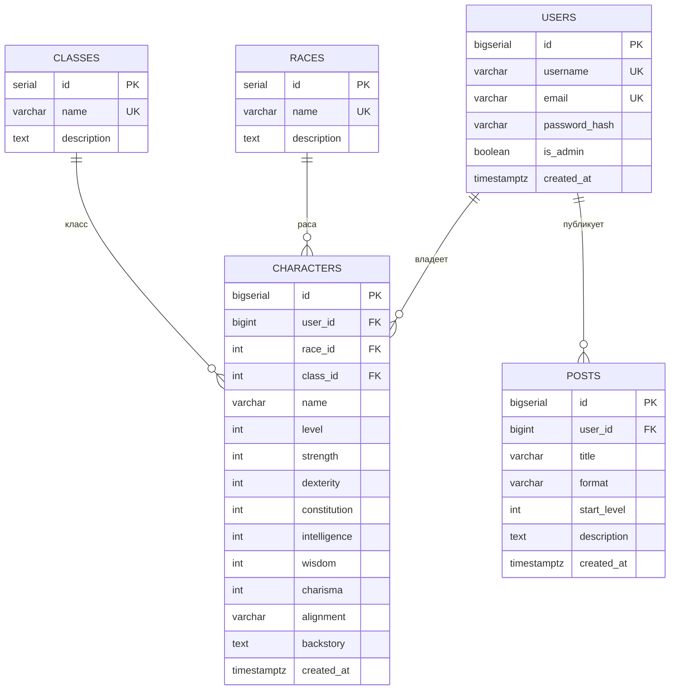

# Персонажи D&D — учебное веб-приложение на PHP MVC

**Отчёт по лабораторной работе**

| | |
|---|---|
| **Тема** | Разработка веб-приложения «Персонажи D&D» с серверной частью |
| **Команда** | «ООО Команда номер 4» |
| **Стек** | PHP 8.2, PostgreSQL 16, Twig 3, Docker, HTML/CSS/JavaScript |
| **Репозиторий** | <https://github.com/Ywxig/DnD> |
| **Запуск** | `docker compose up -d --build` → <http://localhost:8080> |

---

## Содержание

1. [Аннотация](#1-аннотация)
2. [Теоретическая часть](#2-теоретическая-часть)
3. [Постановка задачи](#3-постановка-задачи)
4. [Цель и этапы работы](#4-цель-и-этапы-работы)
5. [Архитектура приложения](#5-архитектура-приложения)
6. [Функциональные возможности](#6-функциональные-возможности)
7. [Сценарии взаимодействия пользователей](#7-сценарии-взаимодействия-пользователей)
8. [Структура базы данных](#8-структура-базы-данных)
9. [Формы и валидация](#9-формы-и-валидация)
10. [Безопасность](#10-безопасность)
11. [Запуск проекта](#11-запуск-проекта)
12. [Примеры использования](#12-примеры-использования)
13. [Соответствие требованиям](#13-соответствие-требованиям)
14. [Выводы](#14-выводы)
15. [Ответы на контрольные вопросы](#15-ответы-на-контрольные-вопросы)
16. [Список использованных источников](#16-список-использованных-источников)

---

## 1. Аннотация

«Персонажи D&D» — веб-приложение для игроков в Dungeons & Dragons. Оно
позволяет зарегистрироваться, создать персонажа с характеристиками, расой,
классом и предысторией, просматривать собственных персонажей, искать героев
по общей базе, публиковать объявления об играх (ваншотах и кампаниях),
а администратору — управлять пользователями через отдельную панель.

Приложение написано на «чистом» PHP 8.2 без фреймворков и следует
архитектуре MVC. Серверная часть отвечает за аутентификацию, валидацию,
работу с PostgreSQL и защиту от типовых веб-атак. Клиентская часть —
адаптивные Twig-шаблоны и небольшой скрипт клиентской валидации.

---

## 2. Теоретическая часть

### 2.1. MVC

**Model–View–Controller** — схема разделения ответственности:

* **Model** — данные и правила работы с ними (SQL-запросы, выборки);
* **View** — представление данных пользователю (HTML-шаблоны);
* **Controller** — обработка запроса: получить данные, проверить их,
  вызвать модель и выбрать представление.

Такое разделение упрощает поддержку: изменение вёрстки не затрагивает
SQL, а изменение схемы БД локализуется в моделях.

### 2.2. Серверные веб-технологии

* **PHP** выполняется на сервере и формирует HTML, который получает браузер.
* **PostgreSQL** хранит пользователей, персонажей и посты.
* **PDO** — единый интерфейс доступа к БД; подготовленные выражения
  отделяют SQL-код от пользовательских данных.
* **Twig** — шаблонизатор с автоматическим экранированием вывода.
* **Сессии** хранят состояние пользователя между запросами (факт входа).
* **Docker** обеспечивает воспроизводимое окружение: PHP + Apache и БД.

### 2.3. Угрозы веб-приложений

| Угроза | Суть | Защита в проекте |
|---|---|---|
| SQL-инъекция | подстановка SQL в пользовательский ввод | подготовленные выражения PDO |
| XSS | внедрение скрипта в HTML | автоэкранирование Twig |
| CSRF | отправка формы от имени пользователя | CSRF-токен в сессии |
| Кража пароля | компрометация БД | `password_hash()` (bcrypt) |
| Фиксация сессии | навязывание чужого идентификатора | `session_regenerate_id(true)` |
| Обход авторизации | прямой вызов закрытого URL | проверка сессии в контроллере |

---

## 3. Постановка задачи

Разработать веб-приложение средней сложности с серверной логикой, которое:

1. реализует регистрацию и вход с безопасным хранением паролей;
2. содержит общедоступный раздел с динамическим контентом из БД;
3. содержит форму создания ресурса (не менее 5 полей разных типов)
   с клиентской и серверной валидацией;
4. содержит форму поиска ресурсов;
5. содержит защищённый раздел, доступный только после входа, и роль
   администратора с управлением данными;
6. следует модульной архитектуре (MVC);
7. документировано: код — PHPDoc, проект — README.

В рамках выбранной предметной области ресурсами являются **персонажи D&D**
и **посты-объявления об играх**.

---

## 4. Цель и этапы работы

**Цель** — получить работающее веб-приложение с серверной частью,
демонстрирующее аутентификацию, работу с БД, формы, валидацию и защиту
данных.

**Этапы:**

1. Проектирование схемы БД и справочников (расы, классы).
2. Реализация ядра: автозагрузка, конфигурация, сессия, роутер,
   базовые Controller/Model, обёртка над PDO.
3. Аутентификация: регистрация, вход, выход, хеширование паролей.
4. CRUD-сценарии предметной области: создание, просмотр, редактирование
   и удаление персонажей.
5. Поиск по базе персонажей.
6. Лента постов и создание объявлений об играх.
7. Валидация форм на клиенте и сервере, обработка ошибок.
8. Защита: CSRF, экранирование, подготовленные запросы, настройки сессии.
9. UI: адаптивная тёмная тема, мобильная вёрстка.
10. Docker-упаковка, документация, отчёт.

---

## 5. Архитектура приложения

### 5.1. Слои

| Слой | Каталог | Назначение |
|---|---|---|
| Точка входа | `public/index.php` | автозагрузка, регистрация маршрутов, запуск роутера |
| Ядро | `src/Core/` | `Router`, `Controller`, `Model`, `Database` |
| Контроллеры | `src/Controllers/` | `Auth`, `Character`, `Post`, `Admin`, `Error` |
| Модели | `src/Models/` | `User`, `Character`, `Race`, `CharClass`, `Post` |
| Валидаторы | `src/Validators/` | `CharacterValidator`, `PostValidator` |
| Хелперы | `src/Helpers/functions.php` | `url()`, `flash()`, CSRF, `current_user()`, Twig |
| Представления | `views/` | Twig-шаблоны, общий `layout.twig` |
| Статика | `public/assets/` | `style.css`, `app.js` |
| БД | `database/` | `schema.sql`, `seed.sql` |

### 5.2. Путь запроса

```
Браузер: GET index.php?r=characters_create
   │
   ▼
public/index.php  ── регистрирует маршруты ──► Router
   │
   ▼
CharacterController::create()
   │ GET  → загрузить расы/классы, показать форму
   │ POST → assert_csrf() → CharacterValidator → Character::create()
   ▼
views/characters/create.twig  (extends layout.twig)
   │
   ▼
HTML → браузер
```

### 5.3. Структура проекта

```
.
├── public/
│   ├── index.php              # PSR-4-подобная автозагрузка и маршруты
│   └── assets/                # style.css, app.js
├── src/
│   ├── bootstrap.php          # конфиг, сессия, ошибки, Twig
│   ├── Core/                  # Database, Router, Controller, Model
│   ├── Controllers/           # Auth, Character, Post, Admin, Error
│   ├── Models/                # User, Character, Race, CharClass, Post
│   ├── Validators/            # CharacterValidator, PostValidator
│   └── Helpers/functions.php  # url, flash, CSRF, current_user, twig
├── views/
│   ├── layout.twig            # шапка, навигация, flash, футер
│   ├── auth/                  # login, register
│   ├── characters/            # my, create, view, find, _form
│   ├── posts/                 # index, create, view, _form
│   ├── admin/                 # users, user_create
│   └── errors/                # 404, 500
├── database/                  # schema.sql, seed.sql, migrations/
├── config/                    # config.example.php, config.php (не в git)
├── Dockerfile
├── docker-compose.yml
├── composer.json
├── GUIDE.md                   # шпаргалка по архитектуре
└── README.md                  # этот отчёт
```

### 5.4. Модульность

* Классы `App\` грузятся по PSR-4 из `src/`; новый контроллер или модель
  достаточно положить в соответствующий каталог.
* Маршрут описывается одной строкой в `public/index.php`.
* Модели наследуют типовые операции (`find`, `all`, `delete`) из `Core\Model`.
* Все запросы к БД проходят через `Core\Database`, поэтому смена СУБД
  или логирование запросов выполняются в одном месте.
* Справочники (расы, классы) вынесены в отдельные таблицы и модели,
  что позволяет расширять список без изменения кода персонажа.

---

## 6. Функциональные возможности

### 6.1. Публичная часть (без входа)

* **Регистрация** — имя пользователя, email, пароль и подтверждение.
* **Вход** — по имени пользователя или email.
* Просмотр страниц ошибок 404 и 500.
* Все остальные разделы перенаправляют гостя на страницу входа.

### 6.2. Для авторизованных пользователей

* **«Мои персонажи»** — таблица собственных персонажей с датой создания;
  пустое состояние предлагает создать героя.
* **Создание персонажа** — форма из 12 полей: имя, раса, класс, уровень,
  мировоззрение, шесть характеристик, предыстория.
* **Карточка персонажа** — метаданные, таблица характеристик с
  модификаторами D&D (`floor((значение − 10) / 2)`), предыстория.
* **Редактирование персонажа** — доступно только владельцу: та же форма,
  что и при создании, с заполненными текущими значениями.
* **Удаление персонажа** — доступно только владельцу, только POST с
  CSRF-токеном и подтверждением в браузере.
* **Поиск персонажей** — по имени, расе, классу, мировоззрению или
  имени игрока; пустой запрос возвращает всех.
* **Лента постов** — объявления об играх с автором и датой.
* **Создание поста** — название, формат (ваншот/кампания), стартовый
  уровень, описание.
* **Карточка поста** — параметры игры и описание.
* **Выход** — очистка и уничтожение сессии.

### 6.3. Административная часть

Доступна только пользователям с флагом `is_admin`. Пункт «Админка»
появляется в навигации автоматически.

* **Список пользователей** — ID, имя, email, роль, число персонажей и
  постов, дата регистрации.
* **Создание пользователя** — форма с именем, email, паролем,
  подтверждением и переключателем «Права администратора». Позволяет
  создавать в том числе новых администраторов.
* **Удаление пользователя** — только POST с CSRF-токеном и
  подтверждением в браузере. Вместе с пользователем каскадно удаляются
  его персонажи и посты. Запрещено удалять собственный аккаунт и
  последнего администратора.

Проверка прав выполняется на сервере функцией `require_admin()`:
обычный пользователь получает сообщение «Доступ запрещён» и редирект
на главную, даже если введёт адрес админки вручную.

### 6.4. Интерфейс

* Тёмная тема, золотой акцент, адаптивная сетка.
* Навигация меняется в зависимости от факта входа.
* Flash-сообщения об успехе и ошибках.
* Подсветка невалидных полей и текст ошибки под каждым полем.
* Таблицы на мобильных устройствах скрывают второстепенные колонки.

### 6.5. Обработка ошибок

* Неизвестный маршрут → страница 404.
* Исключение → запись в `error_log` и страница 500 (в debug-режиме
  выводится сообщение и стек).
* Ошибки валидации → форма возвращается с введёнными данными и
  сообщениями; ничего не теряется.

---

## 7. Сценарии взаимодействия пользователей

### Сценарий 1. Регистрация и первый вход

1. Гость открывает `?r=register`.
2. Заполняет имя, email, пароль и подтверждение.
3. Клиентские подсказки и серверная проверка контролируют формат,
   уникальность имени/email и совпадение паролей.
4. При успехе создаётся запись с bcrypt-хешем и происходит редирект
   на вход с сообщением «Регистрация успешна».
5. После входа открывается «Мои персонажи».

### Сценарий 2. Создание персонажа

1. Пользователь нажимает «+ Персонаж».
2. Выбирает расу и класс из справочников, задаёт уровень,
   мировоззрение и характеристики.
3. `app.js` проверяет поля при вводе; сервер повторяет проверку.
4. При ошибке форма подсвечивает поля; при успехе — редирект на карточку.
5. Владелец видит персонажа в списке «Мои персонажи».

### Сценарий 3. Поиск героя

1. Пользователь открывает «Поиск».
2. Вводит, например, `эльф` или `Воин`.
3. Сервер выполняет `ILIKE`-поиск по имени, расе, классу,
   мировоззрению и имени игрока.
4. Отображается количество найденных и таблица результатов.

### Сценарий 4. Публикация объявления об игре

1. Пользователь открывает «Посты» → «+ Создать пост».
2. Указывает название, формат, стартовый уровень и описание.
3. После серверной валидации пост появляется в ленте сверху.
4. Любой авторизованный пользователь может открыть карточку поста.

### Сценарий 5. Выход

1. Пользователь нажимает «Выход».
2. Сессия очищается, cookie удаляется, происходит редирект на вход.
3. Закрытые страницы снова недоступны.

### Сценарий 6. Работа администратора

1. Администратор входит под `aragorn` и видит в навигации пункт «Админка».
2. В списке пользователей отображаются роли, количество персонажей и постов.
3. Через «+ Добавить пользователя» создаётся новая учётная запись,
   при необходимости — с правами администратора.
4. Удаление пользователя требует подтверждения; сервер проверяет CSRF,
   запрещает удалять себя и последнего администратора.
5. Обычный пользователь (`gimli`) не видит пункт меню, а прямой переход
   по адресу `?r=admin_users` завершается отказом в доступе.

### Сценарий 7. Ошибочный запрос

1. Пользователь вводит несуществующий `?r=...` или `id` персонажа.
2. Сервер возвращает 404 и дружелюбную страницу с кнопкой «На главную».

---

## 8. Структура базы данных

СУБД — PostgreSQL. Схема создаётся файлом `database/schema.sql`,
тестовые данные — `database/seed.sql`.

### 8.1. ER-диаграмма



### 8.2. Таблицы

**`users`** — учётные записи.

| Поле | Тип | Ограничения |
|---|---|---|
| `id` | `BIGSERIAL` | PK |
| `username` | `VARCHAR(50)` | NOT NULL, UNIQUE |
| `email` | `VARCHAR(255)` | NOT NULL, UNIQUE |
| `password_hash` | `VARCHAR(255)` | NOT NULL, bcrypt |
| `is_admin` | `BOOLEAN` | NOT NULL, DEFAULT `FALSE` |
| `created_at` | `TIMESTAMPTZ` | DEFAULT `now()` |

Для существующих баз флаг `is_admin` добавляется миграцией
`database/migrations/001_add_users_is_admin.sql`. Пользователь `aragorn`
из seed-данных является администратором.

**`races`** и **`classes`** — справочники: `id`, уникальное `name`,
`description`. Заполняются seed-скриптом (7 рас, 8 классов).

**`characters`** — персонажи.

| Поле | Тип | Ограничения |
|---|---|---|
| `id` | `BIGSERIAL` | PK |
| `user_id` | `BIGINT` | FK → `users(id)`, `ON DELETE CASCADE` |
| `race_id`, `class_id` | `INTEGER` | FK → справочники |
| `name` | `VARCHAR(50)` | NOT NULL |
| `level` | `INTEGER` | `CHECK (1..20)` |
| `strength`…`charisma` | `INTEGER` | `CHECK (3..18)` |
| `alignment` | `VARCHAR(50)` | NOT NULL |
| `backstory` | `TEXT` | DEFAULT `''` |
| `created_at` | `TIMESTAMPTZ` | DEFAULT `now()` |

Индекс `idx_characters_user_id` ускоряет выборку «мои персонажи».

**`posts`** — объявления об играх.

| Поле | Тип | Ограничения |
|---|---|---|
| `id` | `BIGSERIAL` | PK |
| `user_id` | `BIGINT` | FK → `users(id)`, `ON DELETE CASCADE` |
| `title` | `VARCHAR(100)` | NOT NULL |
| `format` | `VARCHAR(20)` | `CHECK (format IN ('oneshot','campaign'))` |
| `start_level` | `INTEGER` | `CHECK (1..20)` |
| `description` | `TEXT` | DEFAULT `''` |
| `created_at` | `TIMESTAMPTZ` | DEFAULT `now()` |

Индексы: `idx_posts_user_id`, `idx_posts_created_at (DESC)`.

### 8.3. Целостность

* Первичные ключи — суррогатные (`id`).
* Внешние ключи защищают от «висячих» ссылок.
* `ON DELETE CASCADE` удаляет персонажей и посты вместе с пользователем.
* `CHECK`-ограничения дублируют серверную валидацию на уровне БД:
  даже при обходе приложения некорректный уровень или характеристика
  не сохранятся.

---

## 9. Формы и валидация

### 9.1. Форма персонажа (создание ресурса)

12 полей разных типов:

| Поле | HTML-тип | Проверка |
|---|---|---|
| Имя | `text` | 2–50 символов, обязательно |
| Раса | `select` | существует в БД |
| Класс | `select` | существует в БД |
| Уровень | `number` | целое 1–20 |
| Мировоззрение | `select` | одно из 9 значений |
| Сила…Харизма | 6 × `number` | целое 3–18 |
| Предыстория | `textarea` | до 2000 символов, необязательно |

**Клиентская проверка** (`public/assets/app.js`): правила зеркалят
серверные, ошибки выводятся под полем, фокус ставится на первое
невалидное поле, отправка блокируется.

**Серверная проверка** (`src/Validators/CharacterValidator.php`):
единственный источник истины. Проверяются длины, диапазоны, нахождение
расы и класса в справочниках, допустимость мировоззрения.

### 9.2. Форма поста

Поля: название (`text`), формат (`select`), стартовый уровень
(`number`), описание (`textarea`). Серверная валидация —
`src/Validators/PostValidator.php`; на клиенте работают `maxlength`,
`min`/`max` и `required`-подобные ограничения.

### 9.3. Формы аутентификации

* Регистрация: имя (3–30, латиница/цифры/`_`), email
  (`FILTER_VALIDATE_EMAIL`), уникальность, пароль от 6 символов,
  совпадение с подтверждением.
* Вход: непустые логин и пароль; единый текст ошибки, чтобы не
  раскрывать существование аккаунта.

### 9.4. Форма поиска

GET-форма с полем `q`. Сервер обрезает пробелы и передаёт значение
в подготовленный запрос как параметр (шаблон `%...%` для `ILIKE`),
поиск идёт по пяти полям. Результат — таблица с количеством найденных
записей.

---

## 10. Безопасность

* **Хранение паролей.** `password_hash($password, PASSWORD_DEFAULT)` (bcrypt)
  и `password_verify()`. Открытые пароли не хранятся и не логируются.
* **SQL-инъекции.** Все значения передаются как именованные параметры
  подготовленных выражений PDO; `ATTR_EMULATE_PREPARES = false`.
* **XSS.** Twig настроен с `autoescape: html`; ручное экранирование
  доступно через `e()`. Фильтр `nl2br` применяется с предварительным
  экранированием.
* **CSRF.** Токен `random_bytes(32)` хранится в сессии; все POST-формы
  содержат скрытое поле; проверка — `hash_equals()`.
* **Сессия.** Cookie `HttpOnly`, `SameSite=Lax`, `Secure` при HTTPS;
  после входа идентификатор перегенерируется; при удалении пользователя
  сессия сбрасывается.
* **Доступ.** `require_login()` вызывается в каждом защищённом
  контроллере, `require_admin()` — в административном; гость получает
  редирект, а не содержимое. Редактирование и удаление персонажа
  дополнительно проверяют, что текущий пользователь — его владелец,
  иначе возвращается 404.
* **Валидация.** Данные проверяются и на клиенте, и на сервере; сервер
  не доверяет клиенту. `CHECK`-ограничения БД — последний рубеж.
* **Ошибки.** В production-режиме детали не показываются, пишутся в лог.

---

## 11. Запуск проекта

### 11.1. Docker (рекомендуется)

```bash
git clone https://github.com/Ywxig/DnD.git
cd DnD
docker compose up -d --build
```

* Приложение: **<http://localhost:8080>**
* PostgreSQL: `localhost:5433`, БД `dnd`, пользователь `dnd`, пароль `dnd_pass`.
* Схема и seed-данные применяются автоматически при первом создании тома.

Пересоздать базу с нуля:

```bash
docker compose down -v
docker compose up -d --build
```

### 11.2. Без Docker

Требования: PHP ≥ 8.1 с `pdo_pgsql`, `mbstring`, `ctype`; PostgreSQL; Composer.

```bash
createdb dnd
psql -d dnd -f database/schema.sql
psql -d dnd -f database/seed.sql

composer install
cp config/config.example.php config/config.php   # при необходимости
php -S localhost:8000 -t public
```

Приложение: <http://localhost:8000>. Параметры подключения — в
`config/config.php`; переменные окружения `DB_*` имеют приоритет.

### 11.3. Тестовые аккаунты

| Логин | Пароль | Примечание |
|---|---|---|
| `aragorn` | `password123` | администратор |
| `gimli` | `password123` | обычный игрок |

Для базы, созданной до появления админки, флаг выдаётся миграцией:

```bash
psql -h localhost -p 5433 -U dnd -d dnd -f database/migrations/001_add_users_is_admin.sql
```

Также можно зарегистрировать нового пользователя.

### 11.4. Маршруты

| URL | Действие | Доступ |
|---|---|---|
| `?r=login` | вход | публичный |
| `?r=register` | регистрация | публичный |
| `?r=logout` | выход | авторизованный |
| `?r=home` / `?r=characters_my` | мои персонажи | авторизованный |
| `?r=characters_create` | создание персонажа | авторизованный |
| `?r=characters_find&q=...` | поиск персонажей | авторизованный |
| `?r=character_view&id=N` | карточка персонажа | авторизованный |
| `?r=character_edit&id=N` | редактирование персонажа | только владелец |
| `?r=character_delete` | удаление персонажа (POST) | только владелец |
| `?r=posts` | лента постов | авторизованный |
| `?r=posts_my` | мои посты | авторизованный |
| `?r=posts_create` | создание поста | авторизованный |
| `?r=post_view&id=N` | карточка поста | авторизованный |
| `?r=admin_users` | админка: пользователи | администратор |
| `?r=admin_user_create` | создание пользователя | администратор |
| `?r=admin_user_delete` | удаление пользователя (POST) | администратор |

---

## 12. Примеры использования

### 12.1. Регистрация маршрута

```php
$router->add('characters_create', CharacterController::class, 'create');
```

### 12.2. Подготовленный запрос

```php
$row = Database::query(
    'SELECT * FROM users WHERE lower(username) = lower(:username)',
    ['username' => $username]
)->fetch();
```

Имя пользователя никогда не склеивается с SQL-строкой, поэтому
`' OR 1=1 --` остаётся обычным значением.

### 12.3. Безопасное хранение пароля

```php
'password_hash' => password_hash($password, PASSWORD_DEFAULT),
// проверка при входе:
password_verify($password, (string)$user['password_hash']);
```

### 12.4. CSRF в контроллере и шаблоне

```php
assert_csrf();                 // POST-обработчик
```

```twig
<form method="post">
    {{ csrf_field() }}
    ...
</form>
```

### 12.5. Фрагмент формы персонажа

```twig
<select id="alignment" name="alignment">
    
        <option value="{{ alignment }}"
            {{ selected_option(data.alignment, alignment) }}>
            {{ alignment }}
        </option>
    
</select>
```

### 12.6. Пример SQL-выборки поиска

```sql
SELECT c.*, r.name AS race_name, cl.name AS class_name, u.username AS owner_name
FROM characters c
JOIN races r    ON r.id  = c.race_id
JOIN classes cl ON cl.id = c.class_id
JOIN users u    ON u.id  = c.user_id
WHERE c.name ILIKE :name
   OR r.name ILIKE :race
   OR cl.name ILIKE :class
   OR c.alignment ILIKE :alignment
   OR u.username ILIKE :owner
ORDER BY c.id DESC;
```

### 12.7. Расчёт модификатора характеристики

```php
function stat_modifier(int $score): int
{
    return (int)floor(($score - 10) / 2);
}
// 18 → +4, 10 → +0, 7 → −2
```

### 12.8. Проверка прав администратора

```php
function require_admin(): void
{
    require_login();
    if (!current_user_is_admin()) {
        flash('error', 'Доступ запрещён: нужны права администратора.');
        header('Location: ' . url('home'));
        exit;
    }
}
```

Вызов `require_admin()` стоит первым действием в каждом методе
`AdminController`, поэтому проверка не зависит от того, показана ли
ссылка в меню.

---

## 13. Соответствие требованиям

| Требование | Статус | Где реализовано |
|---|---|---|
| Регистрация и вход | ✅ | `AuthController`, `views/auth/` |
| Доступ к закрытым разделам после входа | ✅ | `require_login()`, сессия |
| Хеширование паролей | ✅ | `password_hash()` / bcrypt |
| Восстановление пароля (доп.) | ❌ | не реализовано в текущей версии |
| Общедоступный раздел с контентом из БД | ❌ | публичны только вход и регистрация |
| Форма создания ресурса, ≥ 5 полей разных типов | ✅ | форма персонажа (12 полей) |
| Клиентская и серверная валидация | ✅ | `app.js`, `CharacterValidator`, `PostValidator` |
| Понятные сообщения об ошибках | ✅ | подсветка полей, flash, 404/500 |
| Форма поиска | ✅ | `?r=characters_find&q=...` |
| Защищённый компонент | ✅ | персонажи и посты |
| Роль «администратор» и 3–7 функций | ✅ | список, создание и удаление пользователей (`AdminController`) |
| Управление записями БД (CRUD) | ✅ | персонажи — полный CRUD; посты — создание и чтение |
| Модульная архитектура / MVC | ✅ | `src/Core`, контроллеры, модели, виды |
| PHPDoc | ✅ | все классы и публичные методы |
| README-отчёт | ✅ | этот файл |

**Ограничения текущей версии.** Публичная витрина, восстановление пароля
и редактирование/удаление постов через интерфейс не входят в текущий
срез кода. Карточка персонажа доступна любому авторизованному
пользователю, поскольку персонажи участвуют в общем поиске, но изменять
и удалять персонажа может только его владелец. Эти пункты — ближайшие
направления развития.

---

## 14. Выводы

В ходе работы спроектировано и реализовано веб-приложение с полноценной
серверной частью: аутентификацией, работой с PostgreSQL, валидацией,
поиском и защитой от типовых атак. Использование MVC без фреймворка
позволило явно увидеть, как устроены маршрутизация, доступ к БД и
шаблонизация, а ручная реализация CSRF, сессий и подготовленных
выражений закрепила понимание механизмов безопасности.

Приложение покрывает основные требования лабораторной работы:
регистрация/вход, защищённые разделы, форма создания ресурса с
двусторонней валидацией, форма поиска и административная часть с
управлением пользователями. Публичная витрина и восстановление пароля
остаются направлениями дальнейшей работы; архитектура к этому готова.

**Репозиторий:** <https://github.com/Ywxig/DnD>

---

## 15. Ответы на контрольные вопросы

**1. Что такое MVC и какие преимущества даёт?**
Model–View–Controller — разделение данных, представления и обработки
запроса. Упрощает поддержку и тестирование: вёрстка, бизнес-логика и
SQL меняются независимо. В проекте это `src/Models`, `views/` и
`src/Controllers/`.

**2. Как безопасно хранить пароли?**
Только в виде необратимого хеша с солью: `password_hash()` (bcrypt).
Проверка — `password_verify()`. Пароль нельзя расшифровать; при утечке
БД злоумышленник получает лишь медленные хеши.

**3. Как защититься от SQL-инъекций?**
Использовать подготовленные выражения и передавать данные параметрами,
а не склеивать строки. В проекте — `PDO::prepare()` с именованными
параметрами и отключённой эмуляцией подготовленных выражений.

**4. Что такое XSS и как он предотвращается?**
Внедрение HTML/JavaScript в страницу, которую видят другие пользователи.
Защита — экранирование вывода (`htmlspecialchars`), в проекте
автоматически средствами Twig (`autoescape: html`).

**5. Что такое CSRF?**
Межсайтовая подделка запроса: чужой сайт заставляет браузер
пользователя отправить форму на наш сайт. Защита — одноразовый токен,
привязанный к сессии и проверяемый на сервере.

**6. Зачем нужны сессии?**
HTTP не хранит состояние. Сессия позволяет запомнить факт входа и
данные между запросами. Идентификатор сессии хранится в cookie
`HttpOnly`; после входа он перегенерируется для защиты от фиксации.

**7. Чем отличается клиентская валидация от серверной?**
Клиентская улучшает UX (быстрая подсказка), но легко обходится.
Серверная — обязательна и является источником истины. В проекте
клиентские правила зеркалят серверные, а сервер проверяет всё заново.

**8. Почему выбрана PostgreSQL?**
Строгие типы и ограничения (`CHECK`, `FOREIGN KEY`), надёжные
транзакции, регистронезависимый поиск `ILIKE`, бесплатность и хорошая
поддержка в Docker.

**9. Как обеспечена модульность?**
Единая точка входа и роутер, автозагрузка PSR-4, базовые классы
`Controller`/`Model`, общий слой `Database`, отдельные валидаторы и
справочники. Новая сущность добавляется без изменения существующих
контроллеров.

**10. Какие ограничения у текущей версии?**
Нет публичной витрины, восстановления пароля и редактирования/удаления
постов через UI. Персонажи поддерживают полный CRUD: создание, просмотр,
редактирование и удаление владельцем. Карточка персонажа доступна любому
авторизованному пользователю, но изменять и удалять её может только
владелец. Административная часть реализована: просмотр, создание и
удаление пользователей.

---

## 16. Список использованных источников

1. PHP Documentation. — URL: <https://www.php.net/docs.php> (дата обращения: 24.11.2026).
2. PHP: PDO — Manual. — URL: <https://www.php.net/manual/ru/book.pdo.php>.
3. PostgreSQL 16 Documentation. — URL: <https://www.postgresql.org/docs/16/>.
4. Twig Documentation. — URL: <https://twig.symfony.com/doc/3.x/>.
5. OWASP Cheat Sheet Series: Password Storage, SQL Injection Prevention,
   Cross Site Scripting Prevention, CSRF Prevention. —
   URL: <https://cheatsheetseries.owasp.org/>.
6. MDN Web Docs: HTTP, Cookies, SameSite. — URL: <https://developer.mozilla.org/ru/>.
7. PHP: The Right Way. — URL: <https://phptherightway.com/>.
8. Docker Documentation. — URL: <https://docs.docker.com/>.
9. Документация Composer. — URL: <https://getcomposer.org/doc/>.
10. Dungeons & Dragons: правила и характеристики персонажей. —
    URL: <https://www.dndbeyond.com/>.

---

## Приложение. Что почитать в репозитории

* [`GUIDE.md`](GUIDE.md) — пошаговый разбор архитектуры и пример
  добавления новой сущности.
* `database/schema.sql` — полная схема БД с комментариями.
* `src/Helpers/functions.php` — CSRF, flash, `current_user()`, Twig.
* `src/Validators/` — правила серверной валидации.
* `public/assets/app.js` — клиентская валидация формы персонажа.

> **Примечание.** `config/config.php` содержит локальные пароли и
> исключён из git (`.gitignore`); в Docker параметры передаются через
> переменные окружения `DB_*`.
